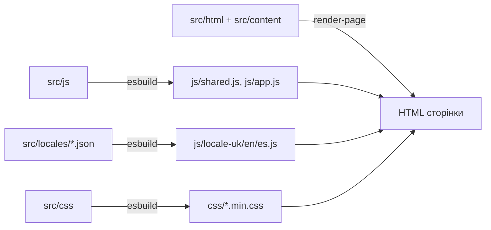

# Тепла зустріч

Сайт спільноти українців та друзів в Іспанії: формат зустрічей, меню, найближча подія, допомога та співпраця. Сайт доступний трьома мовами: українською, іспанською та англійською.

**Сайт:** <https://ua-es.github.io/ua-es/>
**Текст про спільноту:** [docs/about-community.txt](docs/about-community.txt)

> Репозиторій відкритий для перегляду. Копіювати й використовувати код, дизайн, тексти та фото без письмової згоди не можна, докладніше в розділі [Ліцензія](#ліцензія).

## Що всередині

Це статичний сайт без бекенда та фреймворків: HTML, CSS і ванільний JavaScript. Збирання робить [esbuild](https://esbuild.github.io/), перевірки Playwright і вбудований тестовий раннер Node.js, публікація через GitHub Pages.

- Три мови з єдиним каталогом перекладів і тестом, що ключі збігаються.
- Контактна форма не зберігає дані: вона готує текст і відкриває Telegram або пошту.
- Світла й темна теми, зображення у форматі WebP зі `srcset` для адаптивних розмірів, доступність (skip-link, ARIA, `prefers-reduced-motion`).
- CI: тести перед кожною публікацією, бюджет розміру бандла.

## Структура

```text
.
├── src/
│   ├── html/           page.html — єдиний шаблон сторінки
│   ├── content/        тексти сторінки: uk.json, en.json, es.json
│   ├── css/            style/ (12 нумерованих частин стилів), readability.css
│   ├── js/             модулі інтерфейсу: галереї, форма, тема, мова, зображення
│   └── locales/        переклади: uk.json, en.json, es.json
├── index.html, en/, es/  згенеровані сторінки (не редагувати вручну)
├── tools/              допоміжні модулі збирання
├── css/  js/           згенеровані файли (не редагувати вручну)
├── assets/             шрифти, іконки, візерунки, відео, прев'ю для соцмереж
├── images/             фотографії та ілюстрації (WebP)
├── tests/              юніт-тести та e2e (Playwright)
├── build.js            збирання бандлів
├── docs/               додаткова документація
└── .github/workflows/  перевірки якості та публікація
```

Як з вихідних файлів виходить готовий сайт:



## Хто за що відповідає

| Роль | Де працювати | Що перевірити |
| --- | --- | --- |
| Дизайнер | `src/css/`, `assets/` (іконки, візерунки, логотипи), `images/` | вигляд у світлій і темній темі, мобільна версія |
| Перекладач і редактор | `src/content/*.json` (текст сторінки), `src/locales/*.json` (текст інтерфейсу) | ключі однакові в усіх трьох мовах (`npm run test:unit`) |
| Розробник | `src/js/`, `src/html/page.html`, `build.js` | `make check` |
| Організатор | дата, місце й меню зустрічі в `src/content/` | сторінки всіх трьох мов |

## Швидкий старт

Потрібні Node.js 22+ і Python 3.

```sh
npm ci
make dev        # збирання, стеження за src/ і сервер на http://localhost:8000/
```

Перевірки (один раз встановіть браузер: `npx playwright install chromium`):

```sh
make check      # юніт-тести та e2e
make format     # форматування Prettier
```

Усі команди й подробиці: [DEVELOPMENT.md](DEVELOPMENT.md). Як усе влаштоване: [docs/ARCHITECTURE.md](docs/ARCHITECTURE.md).

## Публікація

Після успішних «Quality checks» на гілці `main` workflow `deploy.yml` збирає сайт і публікує його на GitHub Pages. Публікуються лише файли сайту.

## Ліцензія

© 2026 Тепла зустріч. Усі права захищено.

Код і матеріали можна переглядати, але не можна копіювати, змінювати, поширювати чи використовувати без письмової згоди. Усі фотографії належать їхнім авторам, права захищено. Текст: [LICENSE](LICENSE). Сторонні шрифти та залежності: [docs/third-party.md](docs/third-party.md). Щоб запросити дозвіл, напишіть організаторам через форму на сайті.
