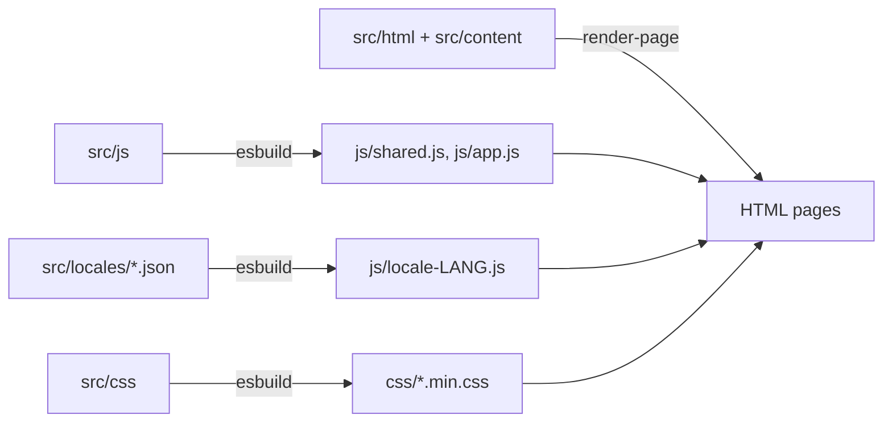

# Тепла зустріч

Website of a community of Ukrainians and friends in Spain: meeting format, menu, the next event, ways to help and cooperate. The site is available in five languages: Ukrainian, Spanish, English, Russian and French.

**Website:** <https://ua-es.github.io/ua-es/>
**About the community and how to join (in Ukrainian):** [CONTRIBUTING.md](CONTRIBUTING.md)

> The repository is open for viewing only. Copying or using the code, design, texts and photos without written permission is not allowed; see [License](#license).

## What is inside

A static site with no backend and no frameworks: HTML, CSS and vanilla JavaScript. [esbuild](https://esbuild.github.io/) builds the bundles, Playwright and the built-in Node.js test runner run the checks, and GitHub Pages publishes the result.

- Five languages with one translation catalog per language and a test that the keys match.
- The contact form stores nothing: it prepares a message and opens Telegram or email.
- Light and dark themes, WebP images with `srcset` for responsive sizes, accessibility (skip link, ARIA, `prefers-reduced-motion`).
- CI: tests before every deployment and a bundle size budget.

## Structure

```text
.
├── src/
│   ├── languages.json  site languages (code, label, path)
│   ├── html/           page.html, the single page template
│   ├── content/        page copy: uk, en, es, ru, fr (*.json)
│   ├── css/            style/ (13 numbered parts), readability.css
│   ├── js/             interface modules: galleries, form, theme, language, images
│   └── locales/        runtime UI strings: uk, en, es, ru, fr (*.json)
├── index.html, en/, es/, ru/, fr/  generated pages (do not edit by hand)
├── tools/              build helpers
├── css/  js/           generated files (do not edit by hand)
├── assets/             fonts, icons, patterns, video, social preview
├── images/             photographs and illustrations (WebP)
├── tests/              unit and e2e (Playwright) tests
├── build.js            bundle build
├── docs/               additional documentation
└── .github/workflows/  quality checks and deployment
```

How the source files become the finished site:



## Who works where

| Role | Where to work | What to check |
| --- | --- | --- |
| Designer | `src/css/`, `assets/` (icons, patterns, logos), `images/` | light and dark themes, mobile layout |
| Translator and editor | `src/content/*.json` (page copy), `src/locales/*.json` (UI strings) | keys are identical in all five languages (`npm run test:unit`) |
| Developer | `src/js/`, `src/html/page.html`, `build.js` | `make check` |
| Organizer | meeting date, place and menu in `src/content/` | pages in all five languages |

## Quick start

Requires Node.js 22+ and Python 3.

```sh
npm ci
make dev        # build, watch src/ and serve at http://localhost:8000/
```

Checks (install the browser once with `npx playwright install chromium`):

```sh
make check      # unit tests and e2e
make format     # Prettier formatting
```

All commands and details: [DEVELOPMENT.md](DEVELOPMENT.md). How everything fits together: [docs/ARCHITECTURE.md](docs/ARCHITECTURE.md).

## Adding a language

1. Copy `src/content/uk.json` and `src/locales/uk.json` to `<code>.json` and translate the values (keep keys, `{placeholders}` and links).
2. Add `{ "code": "<code>", "label": "<LABEL>", "path": "<code>/" }` to `src/languages.json`.
3. Run `npm run build` and `npm test`: the page, `hreflang` links, language switcher and `sitemap.xml` are generated automatically.
4. Add the expected strings of the new language to the `languages` array in `tests/e2e/site.spec.js`.

## Deployment

After a successful "Quality checks" run on `main`, the `deploy.yml` workflow builds the site and publishes it to GitHub Pages. Only the site files are published.

## License

© 2026 Тепла зустріч. All rights reserved.

The code and materials may be viewed, but not copied, modified, distributed or used without written permission. All photographs belong to their authors and all rights are reserved. Text: [LICENSE](LICENSE). Third-party fonts and dependencies: [docs/third-party.md](docs/third-party.md). To ask for permission, write to the organizers through the contact form on the website.
